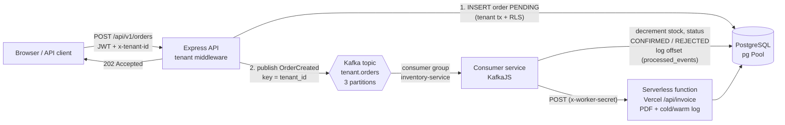

# Multi-Tenant B2B SaaS Platform - CSC337 Lab 06

Shared-database multi-tenant order platform with **Kafka event-driven processing**, **Postgres performance tuning**
(N+1 fix, composite index, connection pooling) and a **serverless invoice worker** with cold/warm start analysis.

| Item | Value |
|---|---|
| Live URL | `https://<your-app>.onrender.com`  <- fill in after deploy |
| Serverless worker | `https://<your-project>.vercel.app/api/invoice`  <- fill in |
| Kafka | `<Aiven / Redpanda Cloud / Confluent bootstrap host>`  <- fill in |
| GitHub | `<your repo url>` |

## Test accounts

| Tenant | `x-tenant-id` | Email | Password |
|---|---|---|---|
| **Tenant A** - Acme Traders | `tenant-a` | `admin@acme.test` | `TenantA#123` |
| **Tenant B** - Globex Retail | `tenant-b` | `admin@globex.test` | `TenantB#123` |

## Architecture



**Request flow:** client -> API gateway (Express + tenant resolution) -> Kafka topic -> consumer group -> DB / serverless worker.

### Components

| Path | Responsibility |
|---|---|
| `src/middleware/tenant.js` | Tenant resolution: `x-tenant-id` header, subdomain, or **JWT claim** (authoritative once logged in). Header/token mismatch -> 403. |
| `src/db.js` | `pg.Pool` (max 10, idle 30s, connect timeout 5s) and `withTenant()` which opens a transaction and sets `app.tenant_id` for Row Level Security. |
| `db/schema.sql` | `tenant_id` on every table, composite foreign keys, **RLS policies** (`ENABLE` + `FORCE`). |
| `src/routes/orders.js` | `POST` -> `202 Accepted` + Kafka publish. `GET ?strategy=n+1\|join`. |
| `src/kafka.js` | Producer (`acks=-1`, idempotent), topic creation (3 partitions), **message key = `tenant_id`**. |
| `src/consumer.js` | Consumer group `inventory-service`: idempotent processing, inventory update, offset log, triggers invoice. |
| `api/invoice.js` | Vercel serverless PDF generator, records `cold_start`, `init_ms`, `duration_ms` in `invoice_logs`. |
| `scripts/benchmark.js` | Seeds 200k orders, runs EXPLAIN ANALYZE before/after index, N+1 vs JOIN, pool vs no pool. |
| `scripts/isolation-test.js` | 16 automated cross-tenant leak checks (HTTP + database level). |
| `scripts/offsets.js` | Prints log-end offset, committed offset and lag per partition (viva helper). |

## 1. Multi-tenancy & isolation

Model: **shared database, shared schema, tenant discriminator column** (`tenant_id`). Defence in depth, three layers:

1. **Resolution** - tenant comes from the signed JWT claim; a conflicting header/subdomain is rejected (403), so a client cannot "switch" tenant.
2. **Application scoping** - every query has `WHERE tenant_id = $1`, and every DB call goes through `withTenant()`.
3. **PostgreSQL Row Level Security** - policy `tenant_id = current_setting('app.tenant_id', true)` on every tenant table, with `FORCE ROW LEVEL SECURITY`.
   Even a query that forgets the `WHERE` returns **0 foreign rows**; a query with *no* tenant context returns 0 rows; cross-tenant INSERT is rejected.
   Composite FKs `(tenant_id, order_id)` / `(tenant_id, product_id)` also make it impossible to link an item to another tenant's order or product.

`set_config('app.tenant_id', ..., true)` is transaction-local, so a pooled connection can never carry one tenant's context into the next request.

> RLS does not apply to PostgreSQL **superusers**. Connect with a normal role (Neon/Supabase default roles are fine).

Run `npm run test:isolation` - last local run: **16/16 checks passed**.

## 2. Database performance (Lecture 17)

Full raw output: [`benchmark/results.md`](benchmark/results.md). Data set: **200,000 orders** (100k per tenant), PostgreSQL 16 on the same machine
(local DB => near-zero network latency, so remote DBs will show a *bigger* N+1 penalty: 51 sequential round trips x RTT).

### 2.1 N+1 -> single JOIN

`GET /api/v1/orders?strategy=n+1` runs 1 query + 1 per order (**51 queries** for 50 orders) - see `listOrdersNPlusOne`.
`GET /api/v1/orders?strategy=join` runs **1 query** (subquery for latest N orders, `LEFT JOIN` items and products, `json_agg`) - see `listOrdersJoin`.

| Strategy | SQL queries | Latency, no index (median) | Latency, with index (median) |
|---|---|---|---|
| N+1 loop | 51 | 36.08 ms | 12.46 ms |
| Single JOIN | 1 | 17.94 ms | **1.43 ms** |

### 2.2 EXPLAIN ANALYZE: composite index `(tenant_id, created_at DESC)`

```sql
SELECT id, status, total, created_at FROM orders WHERE tenant_id = 'tenant-a' ORDER BY created_at DESC LIMIT 50;
CREATE INDEX idx_orders_tenant_created ON orders (tenant_id, created_at DESC);
```

| Query | Before index | After index | Plan change |
|---|---|---|---|
| Latest 50 orders | **23.96 ms** | **0.16 ms** (~145x) | Parallel Seq Scan + top-N heapsort over 100k rows -> Index Scan, 50 rows read, no sort |
| Orders/day, last 7 days | 16.48 ms | 2.63 ms (~6x) | Parallel Seq Scan -> Bitmap Index Scan |

**Before** (excerpt)
```
Limit  (actual time=21.307..24.567 rows=50)
  ->  Gather Merge
        ->  Sort  Sort Key: created_at DESC   Sort Method: top-N heapsort
              ->  Parallel Seq Scan on orders   Filter: (tenant_id = 'tenant-a')   Rows Removed by Filter: 50000
Execution Time: 24.592 ms
```
**After** (excerpt)
```
Limit  (actual time=0.046..0.116 rows=50)
  ->  Index Scan using idx_orders_tenant_created on orders   Index Cond: (tenant_id = 'tenant-a')
Execution Time: 0.132 ms
```
Why the column order matters: equality column (`tenant_id`) first, then the sort/range column (`created_at`), so rows for one tenant are already
stored newest-first in the index and `LIMIT 50` stops after 50 index entries.

> **Screenshots for submission:** run `npm run bench` (or the SQL above in `psql`) and take screenshots of the two plans. Place them in `docs/` and link them here.

### 2.3 Connection pooling

`src/db.js` uses a shared `pg.Pool` (`max=10`). 300 queries at concurrency 30:

| Mode | Total time |
|---|---|
| `pg.Pool` (max 10) | 42.7 ms |
| New connection per query | 650.2 ms (**~15x slower**) |

Beyond speed, the cap protects Postgres from connection storms (each backend ~10 MB). Live stats: `GET /api/v1/metrics/pool`.
On serverless (Vercel) set `PG_POOL_MAX=1..2` and use the provider's pooled connection string (Neon `-pooler` host / Supabase pgbouncer).

## 3. Kafka event-driven flow (Lecture 18)

* `POST /api/v1/orders` validates, stores the order as `PENDING`, publishes `OrderCreated` and returns **`202 Accepted`** with the Kafka partition/offset. If the broker is down the order is marked `FAILED` and the API returns 503.
* **Partitioning & ordering:** message key = `tenant_id`. Kafka hashes the key to a partition, so all events of one tenant stay in one partition and are consumed in order; different tenants are processed in parallel. (Ordering is guaranteed per partition only.)
* **Consumer group** `inventory-service` (KafkaJS): per event, in one tenant-scoped DB transaction - insert into `processed_events` (idempotency; Kafka is at-least-once), decrement stock (`stock >= qty` guard; rollback to savepoint -> order `REJECTED`), set order `CONFIRMED`. The partition/offset is stored in `processed_events` and printed:
  ```
  [consumer] topic=tenant.orders partition=0 offset=1 key=tenant-a order=d76bea34-... -> REJECTED
  ```
* Scale-out: start more consumer processes with the same `groupId`; Kafka rebalances partitions between them.

## 4. Serverless worker & cold-start analysis (Lecture 17)

`api/invoice.js` (Vercel) generates a PDF invoice for a confirmed order. The consumer calls it with a shared secret.
Module scope (`require`s, DB pool, `coldStart` flag) runs once per container; the handler runs every time.

| Invocation | Type | Total | Module init |
|---|---|---|---|
| 1 | **cold** | 127 ms | 110 ms |
| 2 | warm | 7 ms | 0 |
| 3 | warm | 9 ms | 0 |

*(Local simulation of the handler. After deploying, replace with real numbers from `GET /api/v1/metrics/invoices` and the `x-cold-start` response header.
Real Vercel cold starts typically add network + DB-connect time on top, so expect hundreds of ms.)*

Observations to write up: cold = container boot + module load + first DB connection; warm = reuse of the container and open connection.
Mitigations: lazy-require heavy libraries, keep the bundle small, reuse the pool at module scope, pooled DB URL, keep-warm pings, or move the call off the user's critical path (it already is - it is triggered by Kafka, not by the HTTP request).

## Run locally

```bash
cp .env.example .env              # edit if needed
docker compose up -d              # Postgres + Redpanda (Kafka) + Redpanda Console on http://localhost:8080
npm install
npm run db:init && npm run db:seed
npm start                         # terminal 1: API on :3000   (set RUN_CONSUMER=false)
npm run consumer                  # terminal 2: consumer, prints partition/offset
npm run test:isolation            # terminal 3
npm run bench                     # EXPLAIN ANALYZE benchmark (BENCH_ORDERS=100000)
npm run offsets                   # committed offset vs log-end offset (lag)
```
No Docker? `KAFKA_DRIVER=memory RUN_CONSUMER=true npm start` runs the whole flow in one process (dev only, no real broker).

## Deploy

1. **Postgres** - Neon or Supabase (free). Copy the connection string -> `DATABASE_URL`, `PG_SSL=true`.
2. **Kafka** - Aiven for Apache Kafka free tier, Redpanda Cloud Serverless or Confluent Cloud. Create SASL user; set `KAFKA_BROKERS`, `KAFKA_USERNAME`, `KAFKA_PASSWORD`, `KAFKA_SSL=true`, `KAFKA_SASL_MECHANISM` (`scram-sha-256`/`scram-sha-512`/`plain` as your provider says). Create topic `tenant.orders` with 3 partitions if the app is not allowed to. If your provider rejects idempotent producers set `KAFKA_IDEMPOTENT=false`.
3. **Vercel** - import the repo, env vars `DATABASE_URL`, `PG_SSL=true`, `PG_POOL_MAX=2`, `WORKER_SECRET`. Function URL: `https://<project>.vercel.app/api/invoice`.
4. **Render** - new Web Service from the repo (`render.yaml` included). Env: everything in `.env.example`, `RUN_CONSUMER=true` (consumer runs inside the web service), `INVOICE_WORKER_URL=<vercel url>`, same `WORKER_SECRET`. Frontend is served by Express from `public/`.
5. Put the URLs at the top of this README and in the test: `BASE_URL=https://<app> npm run test:isolation`.

## Viva cheat sheet

| They ask | You do |
|---|---|
| Trigger an event live | UI -> "Place order" / "Burst x10", or `curl -XPOST $URL/api/v1/orders -H "authorization: Bearer $T" -H 'content-type: application/json' -d '{"items":[{"productId":1,"quantity":2}]}'` |
| Show consumer offsets | Consumer terminal log (partition/offset per message), `npm run offsets`, Redpanda Console, or `SELECT kafka_partition, kafka_offset, outcome FROM processed_events ORDER BY processed_at DESC` |
| Show ordering | Burst x10 as Tenant A: all land in the same partition with increasing offsets |
| EXPLAIN ANALYZE | `DROP INDEX idx_orders_tenant_created;` run the query, `\i db/indexes.sql`, run again (see section 2.2; set tenant via `SELECT set_config('app.tenant_id','tenant-a',false);` first because RLS is forced) |
| Prove isolation | `npm run test:isolation`; in psql with `app.tenant_id='tenant-b'`, `SELECT * FROM orders` shows no tenant-a rows |
